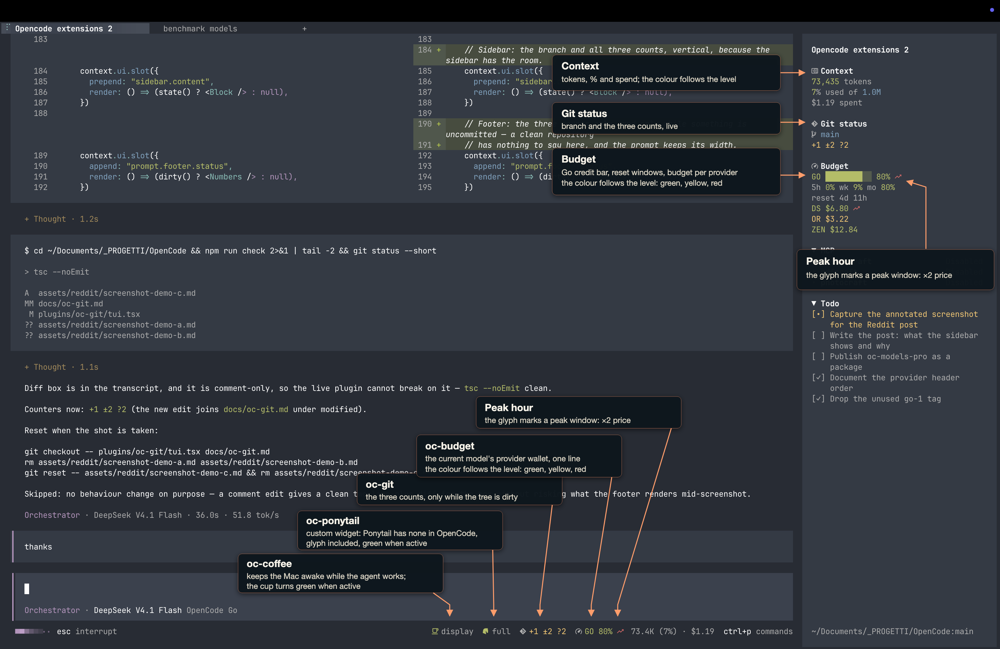
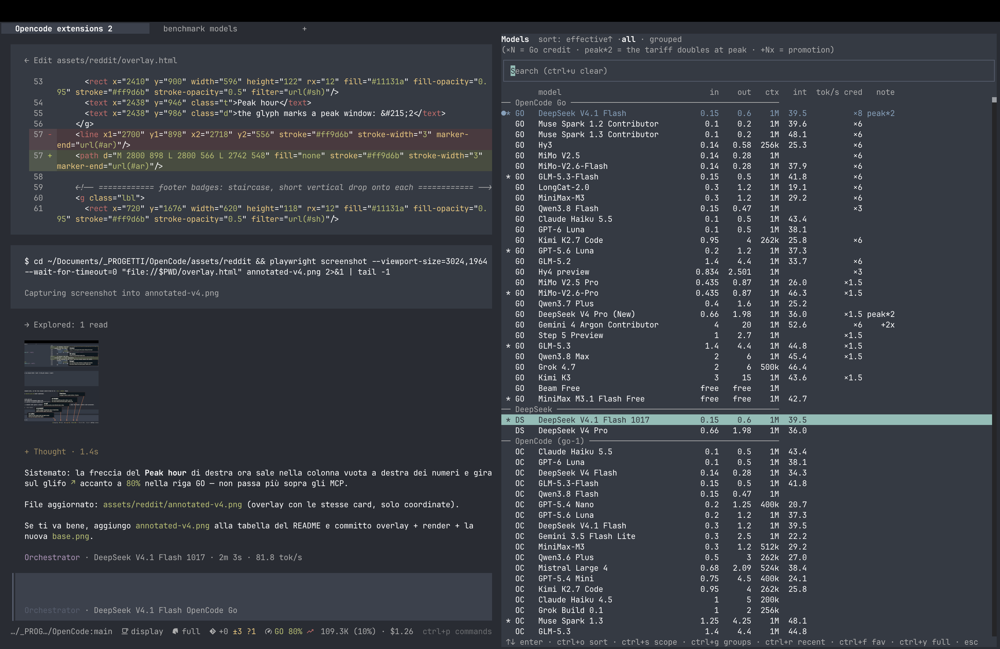

# OpenCode plugins

Plugins I build for my own workflow. The sources are here to be read and forked.

The TUI with the widgets below, and the model picker:





| plugin | what it does | npm |
|---|---|---|
| `@rizal72/oc-models-pro` | `/models-pro`: every model with its price, context, intelligence index and the Go credit, in a session panel | ✓ |
| `@rizal72/oc-git` | the repository in the sidebar: branch, the three counts, ahead/behind; the counts in the footer while dirty | ✓ |
| `@rizal72/oc-coffee` | keeps the Mac awake while the agent works: cup badge in the footer, `/coffee` — macOS only | ✓ |
| `@rizal72/oc-ponytail-widget` | the ponytail level as a badge in the prompt footer | ✓ |
| `@rizal72/oc-session-search` | `session_search`: keyword search over the transcripts of past sessions | ✓ |
| `oc-context` | the Context block in the sidebar, with the window its percent is a percent of | — redraws a built-in |
| `oc-budget` | the paying provider's budget: sidebar, footer, `/budget` | — my wallet |
| `oc-donsetch` | keeps the `donsetch` binary current | — needs that binary |

## Install

```sh
opencode plugin add @rizal72/oc-models-pro
opencode plugin add @rizal72/oc-git
opencode plugin add @rizal72/oc-coffee
opencode plugin add @rizal72/oc-ponytail-widget
opencode plugin add @rizal72/oc-session-search
```

Each plugin directory is a package of its own: a `package.json`, an `index.ts` for the server half and a
`tui.tsx` for the half that draws. `npm run check` type-checks all of them.

The four marked `—` are here to be read: they assume something about my setup (a wallet, a rules file, a
binary), so packaging them would only sell you a config you do not have.

Where these came from: [Why I left OpenCode for Pi, then came back for v2](https://www.reddit.com/r/opencodeCLI/comments/1xcgnpr/why_i_left_opencode_for_pi_then_came_back_for_v2/).
