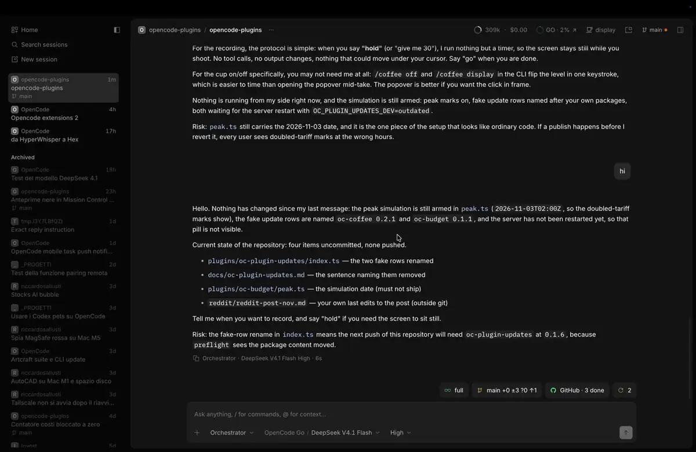

# OpenCode plugins

Plugins for OpenCode v2, built for my own workflow and published because they turned out useful to others.
The sources are here to be read and forked.

Each one says what it does in **the terminal**, in **the desktop app**, or in neither (a tool that only the
agent calls). One plugin, one state, two surfaces, GUI and TUI:



| plugin | what it does | TUI | GUI | npm |
|---|---|---|---|---|
| [`@rizal72/oc-models-pro`](plugins/oc-models-pro/README.md) | `/models-pro`: every model with its price, context, intelligence index, tok/s and the Go credit | ✓ | ✓ | ✓ |
| [`@rizal72/oc-budget`](plugins/oc-budget/README.md) | the paying provider's budget: sidebar, footer, `/budget` | sidebar, footer, `/budget` | the figure in the session header, with a popover | ✓ |
| [`@rizal72/oc-plugin-updates`](plugins/oc-plugin-updates/README.md) | update OpenCode plugins: one by one or all of them at once | a line in the sidebar, and a dialog on `/plugin-updates` | a pill above the composer | ✓ |
| [`@rizal72/oc-notify`](plugins/oc-notify/README.md) | a notification on the phone when a turn ends | — | a settings page for the four choices | ✓ |
| [`@rizal72/oc-git`](plugins/oc-git/README.md) | the repository: branch, the three counts, ahead/behind | sidebar, and the counts in the footer while dirty | a pill above the composer | ✓ |
| [`@rizal72/oc-coffee`](plugins/oc-coffee/README.md) | keeps the Mac awake while the agent or a command is working (macOS only) | cup badge in the footer, `/coffee` | a cup in the session header, with the four levels | ✓ |
| [`@rizal72/oc-ponytail-widget`](plugins/oc-ponytail-widget/README.md) | the ponytail level | badge in the footer | a pill, and the only selector | ✓ |
| [`@rizal72/oc-session-search`](plugins/oc-session-search/README.md) | `session_search`: keyword search over the transcripts of past sessions | — | — | ✓ |
| [`oc-context`](plugins/oc-context/README.md) | the Context block in the sidebar, with the window its percent is a percent of | sidebar | — | — redraws a built-in |
| [`oc-donsetch`](plugins/oc-donsetch/README.md) | keeps the `donsetch` binary current | — | — | — needs that binary |

Something broken? Open an issue: https://github.com/rizal72/opencode-plugins/issues — paste the error line
and the opencode version. That is the whole form.

A plugin that **vanishes after an update** — `opencode plugin list` no longer shows it, and it draws nothing —
is a server that reloaded plugins while the package was being replaced, and skipped the entry without saying
so. Restart it with `opencode service restart`: nothing is lost, and the plugin comes back.

## Install

```sh
opencode plugin add @rizal72/oc-models-pro
opencode plugin add @rizal72/oc-budget
opencode plugin add @rizal72/oc-plugin-updates
opencode plugin add @rizal72/oc-notify
opencode plugin add @rizal72/oc-git
opencode plugin add @rizal72/oc-coffee
opencode plugin add @rizal72/oc-ponytail-widget
opencode plugin add @rizal72/oc-session-search
```

Each plugin directory is a package of its own: a `package.json`, an `index.ts` for the server half, a
`tui.tsx` for the terminal and a `gui.tsx` for the desktop app where one exists. The server half owns the
state; the two halves that draw only display it, which is why the same facts hold on both surfaces.
`npm run check` type-checks all of them.

## Update

V2 checks package plugins at startup and never applies the update, so a package only moves when you ask:

```sh
opencode plugin check     # which of the installed packages are behind
opencode plugin update    # apply them, and let the server reload
```

Or install [`@rizal72/oc-plugin-updates`](https://www.npmjs.com/package/@rizal72/oc-plugin-updates): the
count appears in a pill above the composer, with the update one click away.

The ones marked `—` in the npm column are here to be read: `oc-context` takes over a built-in and needs a line
in `cli.json`, and `oc-donsetch` only updates a binary you install yourself, so neither is a package. The rest
install with `opencode plugin add`, and `oc-notify` asks for one thing more — the free ntfy app on the phone.

Where these came from: [Why I left OpenCode for Pi, then came back for v2](https://www.reddit.com/r/opencodeCLI/comments/1xcgnpr/why_i_left_opencode_for_pi_then_came_back_for_v2/).

Speed figures that `models-pro` shows with a `~` come from [Artificial Analysis](https://artificialanalysis.ai/), used under their free API terms.
