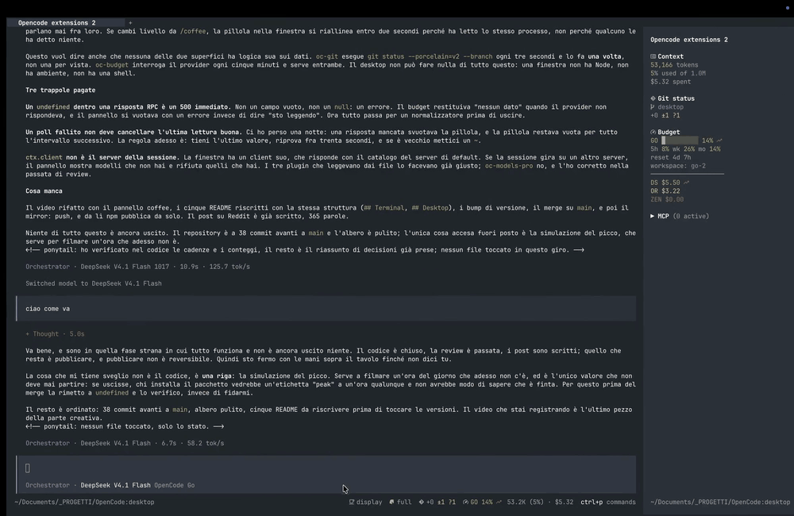

# OpenCode plugins

Plugins I build for my own workflow. The sources are here to be read and forked.

Each one says what it does in **the terminal**, in **the desktop app**, or in neither (a tool that only the
agent calls). One plugin, one state, two surfaces — the terminal half first, then the desktop app:



| plugin | what it does | TUI | GUI | npm |
|---|---|---|---|---|
| `@rizal72/oc-models-pro` | `/models-pro`: every model with its price, context, intelligence index, tok/s and the Go credit | ✓ | ✓ | ✓ |
| `@rizal72/oc-git` | the repository: branch, the three counts, ahead/behind | sidebar, and the counts in the footer while dirty | a pill above the composer | ✓ |
| `@rizal72/oc-coffee` | keeps the Mac awake while the agent works | cup badge in the footer, `/coffee` | a pill with the four levels | ✓ |
| `@rizal72/oc-ponytail-widget` | the ponytail level | badge in the footer | a pill, and the only selector | ✓ |
| `@rizal72/oc-session-search` | `session_search`: keyword search over the transcripts of past sessions | — | — | ✓ |
| `@rizal72/oc-plugin-updates` | which installed plugins the registry has moved past, updated on a click | — | a pill above the composer | ✓ |
| `oc-context` | the Context block in the sidebar, with the window its percent is a percent of | sidebar | — | — redraws a built-in |
| `oc-budget` | the paying provider's budget: sidebar, footer, `/budget` | sidebar, footer, `/budget` | a pill | — my wallet |
| `oc-donsetch` | keeps the `donsetch` binary current | — | — | — needs that binary |

Something broken? Open an issue: https://github.com/rizal72/opencode-plugins/issues — paste the error line
and the opencode version. That is the whole form.

## Install

```sh
opencode plugin add @rizal72/oc-models-pro
opencode plugin add @rizal72/oc-git
opencode plugin add @rizal72/oc-coffee
opencode plugin add @rizal72/oc-ponytail-widget
opencode plugin add @rizal72/oc-session-search
opencode plugin add @rizal72/oc-plugin-updates
```

Each plugin directory is a package of its own: a `package.json`, an `index.ts` for the server half, a
`tui.tsx` for the terminal and a `gui.tsx` for the desktop app where one exists. The server half owns the
state; the two halves that draw only display it, which is why the same facts hold on both surfaces.
`npm run check` type-checks all of them.

## Update

V2 checks package plugins at startup and never applies the update, so a package only moves when you ask:

```sh
opencode plugin check     # which of the installed packages are behind
opencode plugin update    # apply them, and let the server reload
```

Or install [`@rizal72/oc-plugin-updates`](https://www.npmjs.com/package/@rizal72/oc-plugin-updates): the
count appears in a pill above the composer, with the update one click away.

The ones marked `—` in the npm column are here to be read: they assume something about my setup (a wallet,
a rules file, a binary), so packaging them would only sell you a config you do not have.

Where these came from: [Why I left OpenCode for Pi, then came back for v2](https://www.reddit.com/r/opencodeCLI/comments/1xcgnpr/why_i_left_opencode_for_pi_then_came_back_for_v2/).

Speed figures that `models-pro` shows with a `~` come from [Artificial Analysis](https://artificialanalysis.ai/), used under their free API terms.
